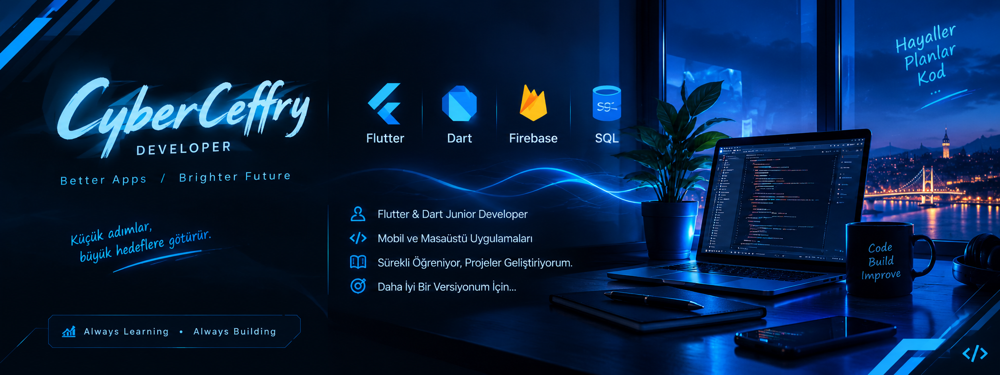

<p align="center">
  
</p>

<h2 align="center">⚡ CYBERCEFFRY | DEVELOPER ⚡</h2>

<p align="center">
  <b>Flutter & Dart Junior Developer</b><br>
  Mobil ve masaüstü uygulamalar geliştiriyorum.
</p>

<p align="center">
  
  
  
  
</p>

---

<h3>▸ SYSTEM PROFILE</h3>

```text
STATUS      : ALWAYS LEARNING
FOCUS       : FLUTTER / DART
PLATFORM    : MOBILE & DESKTOP
MISSION     : BUILD • LEARN • IMPROVE
```

<h3>▸ TECHNOLOGY MATRIX</h3>

<p align="center">
  
</p>

---

<h3>▸ GITHUB ACTIVITY</h3>

<p align="center">
  
  
</p>


<p align="center">
  
</p>


---

<h3 align="center">[ CODE ] [ BUILD ] [ IMPROVE ]</h3>

<p align="center">
  <i>Her gün daha iyi bir versiyonum için. 🚀</i>
</p>
